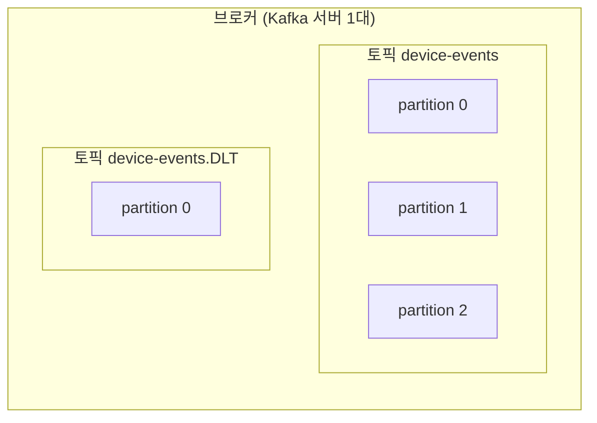
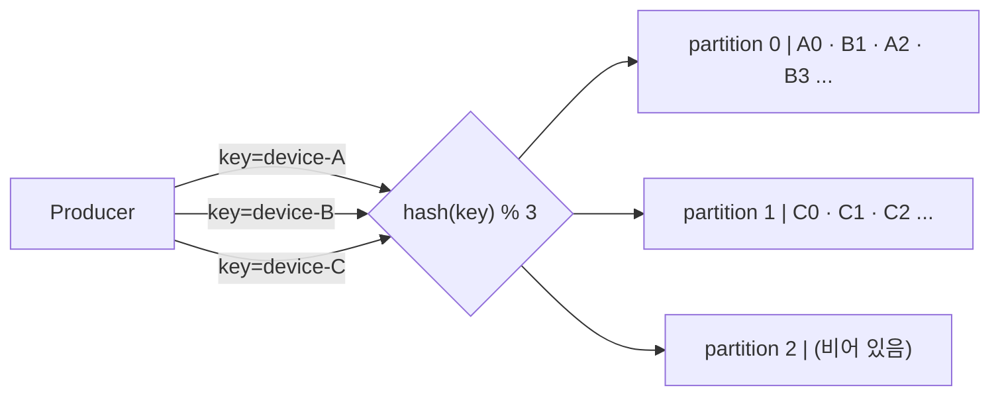
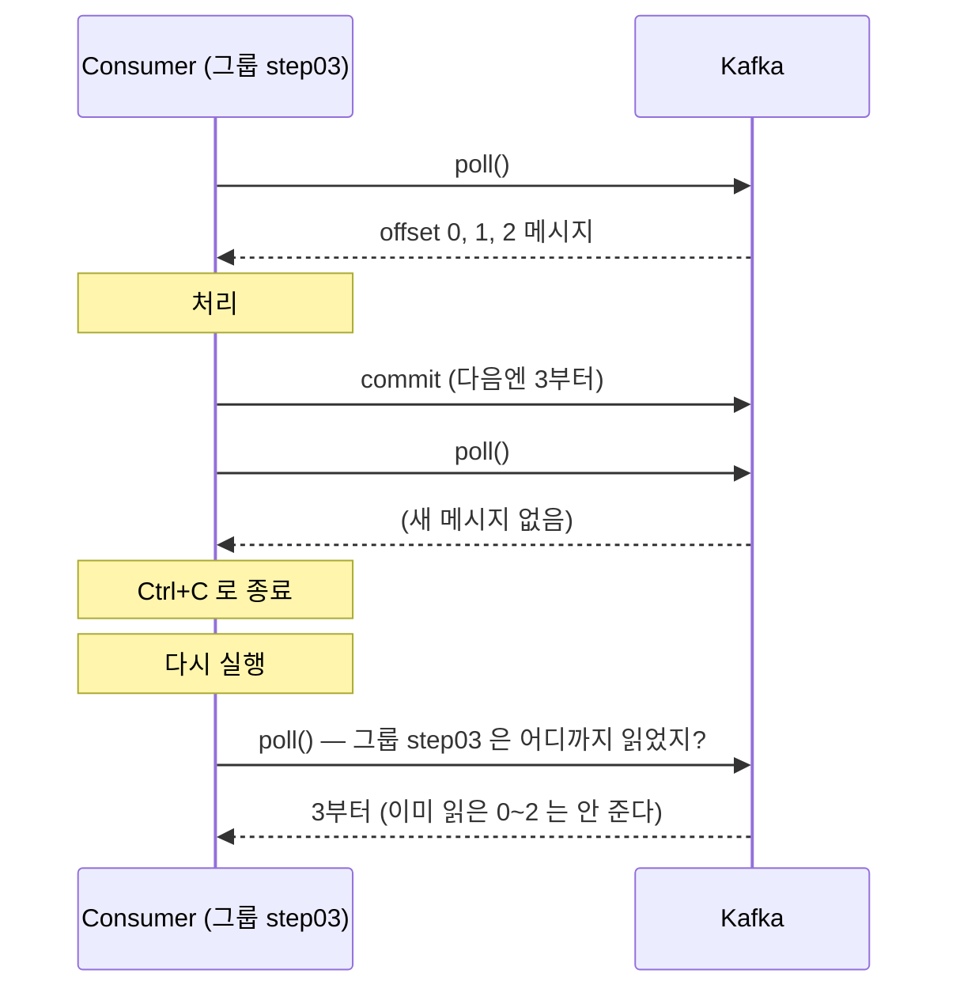
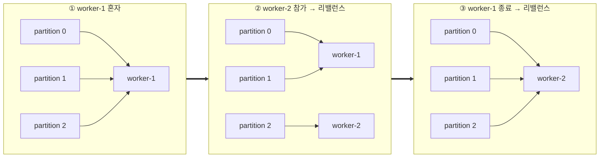
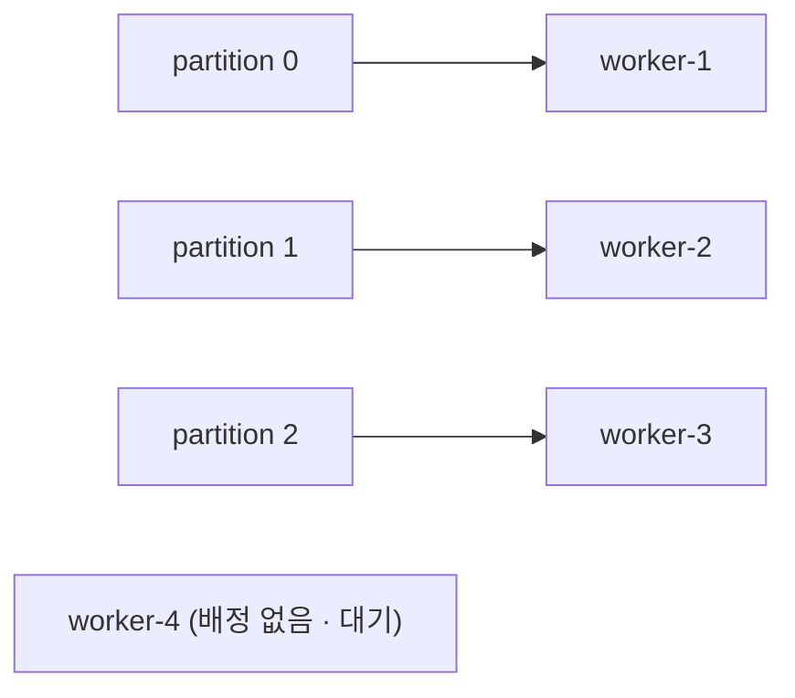
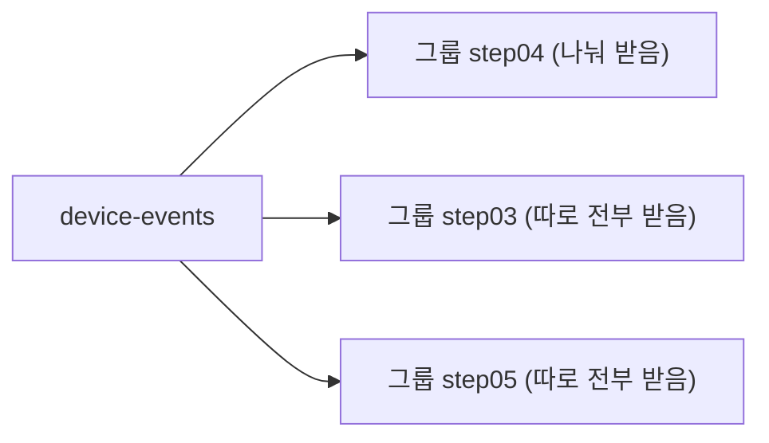
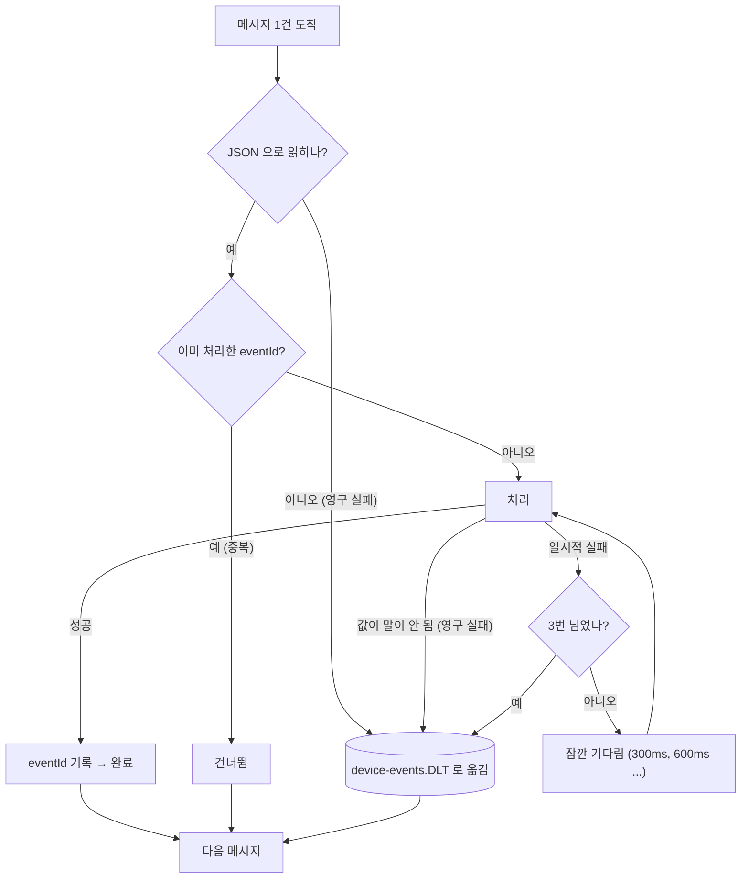
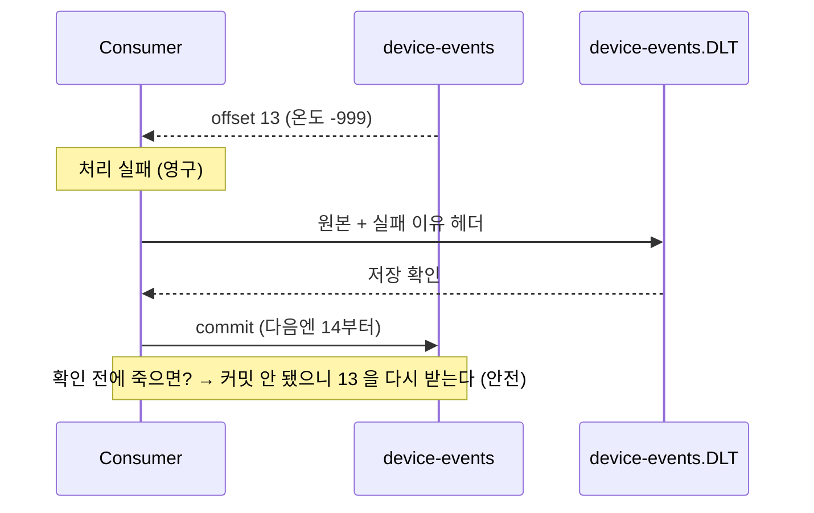

# Kafka Basic

Apache Kafka 를 **처음 써 보는 사람**을 위한 연습 저장소.

**Spring 없이 공식 Java 클라이언트(`kafka-clients`)만으로** 토픽 · 프로듀서 · 컨슈머 · 소비자 그룹 · 재시도 · DLT 를 단계별로 돌려 본다.
`@KafkaListener` 한 줄 뒤에 숨어 있는 poll 루프, offset 커밋, 리밸런스를 직접 보는 것이 목적이다.

```
 ┌──────────────┐   send(key, value)   ┌───────────────────────────┐   poll()    ┌──────────────┐
 │   Producer   │ ───────────────────▶ │ topic: device-events      │ ──────────▶ │   Consumer   │
 │ (설비 이벤트) │                      │  ├ partition 0  [0][1][2]… │             │  (group)     │
 └──────────────┘                      │  ├ partition 1  [0][1]…    │             └──────┬───────┘
                                       │  └ partition 2  [0]…       │                    │ 처리 실패
                                       └───────────────────────────┘                    ▼
                                                                         topic: device-events.DLT
```

---

## 요구사항

- **Java 21**
- **Docker** (Kafka 를 띄우고, 통합 테스트에서도 쓴다)
- Gradle 은 Wrapper 포함

## 빠른 시작

```bash
# 1. Kafka 띄우기 (KRaft 단일 노드)
docker compose up -d
#    웹 UI 도 같이: docker compose --profile ui up -d   → http://localhost:8989

# 2. 단계별 실행
./gradlew topic                    # Step 01 토픽 만들기
./gradlew produce -Pargs="12"      # Step 02 보내기
./gradlew consume                  # Step 03 받기          (Ctrl+C 종료)
./gradlew group -Pargs="worker-1"  # Step 04 소비자 그룹   (터미널 여러 개)
./gradlew produceBad               # Step 05 문제 섞인 메시지 보내기
./gradlew reliable                 # Step 05 중복 · 재시도 · DLT 처리

# 3. 정리
docker compose down
```

> **9092 포트를 이미 다른 Kafka 가 쓰고 있다면** 포트를 바꾼다. 예제 코드도 같은 변수를 읽는다.
> ```bash
> export KAFKA_PORT=9192
> docker compose up -d && ./gradlew topic
> ```
> 실행하면 첫 줄에 `브로커 localhost:9192 에 연결` 처럼 **어느 브로커에 붙는지** 찍힌다. 엉뚱한 Kafka 에 토픽을 만들지 않았는지 꼭 본다.

## 단계별 따라 하기

> 처음이라면 [01-개념](docs/01-개념.md) 의 **용어 표**만 먼저 훑고 오면 아래가 훨씬 쉽다.
> 토픽 · 파티션 · offset · 소비자 그룹, 이 네 단어만 알면 된다.

전체 흐름은 이렇다.

```
Step 01  토픽(메시지 담을 통)을 만든다
Step 02  메시지를 넣는다                      ← 키에 따라 어느 칸(파티션)에 들어가는지 본다
Step 03  메시지를 꺼낸다                      ← 어디까지 읽었는지(offset) Kafka 가 기억한다
Step 04  여러 명이 나눠서 꺼낸다              ← 한 명이 빠지면 남은 사람이 이어받는다
Step 05  이상한 메시지가 와도 멈추지 않는다   ← 중복 · 재시도 · 따로 빼 두기(DLT)
```

---

### Step 01 — 토픽 만들기

**배우는 것**: 토픽은 메시지를 담는 이름 붙은 통이다. 통 안은 **파티션**이라는 칸 여러 개로 나뉘어 있다.
이 실습의 `device-events` 토픽은 칸이 3개다.




```bash
./gradlew topic
```

**실제 출력**

```
브로커 localhost:9092 에 연결
토픽 생성: device-events (파티션 3)
토픽 생성: device-events.DLT (파티션 1)
── device-events ──
  partition=0 leader=1 replicas=1 isr=1
  partition=1 leader=1 replicas=1 isr=1
  partition=2 leader=1 replicas=1 isr=1
```

**읽는 법**
- `partition=0,1,2` — 칸이 3개 만들어졌다.
- `leader=1` — 그 칸을 맡은 브로커(서버) 번호. 브로커가 1대뿐이라 전부 1.
- `replicas`, `isr` — 칸의 복사본 수. 운영에서는 브로커가 죽어도 안 잃도록 3개 정도 둔다. 실습은 1.
- `device-events.DLT` 는 Step 05 에서 처리 못 한 메시지를 옮겨 둘 통이다.

**해 볼 것**: 한 번 더 실행해 보면 `이미 있음` 이 나온다.

코드: [TopicSetup.java](src/main/java/com/clnewze/lab/kafka/step01/TopicSetup.java)

---

### Step 02 — 메시지 보내기 (Producer)

**배우는 것**: 메시지를 보낼 때 **키**를 붙인다. 이 실습에서는 키가 설비 번호(`device-A`, `device-B`, `device-C`)다.
**같은 키는 항상 같은 칸(파티션)에 들어간다.** 그래서 같은 설비의 메시지는 보낸 순서대로 쌓인다.



칸 안에서는 뒤에 붙기만 한다. 칸마다 번호(offset)가 0 부터 따로 붙는다.

```
partition 0 : [0:A] [1:B] [2:A] [3:B] [4:A] ...  → 새 메시지는 오른쪽 끝에
partition 1 : [0:C] [1:C] [2:C] ...
```


```bash
./gradlew produce -Pargs="9"     # 9건 보내기
```

**실제 출력**

```
보냄 key=device-A → partition=0 offset=0
보냄 key=device-B → partition=0 offset=1
보냄 key=device-A → partition=0 offset=2
보냄 key=device-B → partition=0 offset=3
보냄 key=device-C → partition=1 offset=0
보냄 key=device-C → partition=1 offset=1
9건 전송 끝
```

**읽는 법**
- `device-A` 는 몇 번을 보내도 `partition=0`. `device-C` 는 늘 `partition=1`. → **키 = 칸 고정**
- `offset` 은 칸 안에서 붙는 번호. 0, 1, 2 … 로 늘어난다. **칸마다 따로 센다** (partition 1 은 다시 0 부터).
- `device-A`, `device-B` 가 같은 칸에 몰렸다. 키가 3개, 칸이 3개라도 고르게 나뉜다는 보장은 없다.
- 순서가 지켜지는 건 **한 칸 안에서만**이다. device-A 와 device-C 사이의 순서는 보장되지 않는다.

**코드에서 볼 설정**

| 설정 | 뜻 |
|---|---|
| `acks=all` | 브로커가 "확실히 저장했다" 고 할 때까지 기다린다 (유실 방지) |
| `enable.idempotence=true` | 네트워크 문제로 다시 보내도 두 번 저장되지 않는다 |
| `send(record, callback)` | 보내기는 바로 끝나고, 결과(어느 칸 몇 번)는 나중에 콜백으로 온다 |

코드: [SimpleProducer.java](src/main/java/com/clnewze/lab/kafka/step02/SimpleProducer.java)

---

### Step 03 — 메시지 받기 (Consumer)

**배우는 것**: 받는 쪽은 Kafka 가 밀어 주는 걸 기다리는 게 아니라 **스스로 당겨 온다**(`poll`).
다 처리하면 "여기까지 읽었다" 를 Kafka 에 적어 둔다(**커밋**). 그래서 껐다 켜도 **이어서** 읽는다.



```
partition 0 : [0] [1] [2] [3] [4] [5]
                          ▲
              그룹 step03 의 커밋 위치 (다음에 읽을 곳)
              그룹 other  은 아직 커밋이 없다 → 맨 앞 [0] 부터
```


```bash
./gradlew consume      # Ctrl+C 로 종료
```

**실제 출력**

```
그룹 'step03' 로 'device-events' 구독 시작
받음 partition=1 offset=0 key=device-C value={"eventId":"…","deviceId":"device-C","type":"TEMPERATURE","value":23.3,…}
받음 partition=0 offset=0 key=device-A value={…}
받음 partition=0 offset=1 key=device-B value={…}
```

**해 볼 것 — 이게 Step 03 의 핵심**

| 순서 | 할 일 | 결과 | 이유 |
|---|---|---|---|
| 1 | `./gradlew consume` | 보낸 메시지가 다 나온다 | 이 그룹은 처음이라 맨 앞부터 읽는다 (`auto.offset.reset=earliest`) |
| 2 | Ctrl+C 후 다시 `./gradlew consume` | **아무것도 안 나온다** | 1 에서 커밋한 위치 다음부터 읽기 때문 |
| 3 | 다른 터미널에서 `./gradlew produce -Pargs="3"` | 새로 보낸 3건만 나온다 | |
| 4 | `./gradlew consume -Pargs="other"` | **처음부터 다시** 다 나온다 | 그룹 이름이 다르면 읽은 위치도 따로다. 읽어도 메시지는 지워지지 않는다 |

**코드에서 볼 것**
- `enable.auto.commit=false` 로 자동 커밋을 끄고, 처리한 **뒤에** `commitSync()` 한다. 처리 전에 커밋하면 처리 중 죽었을 때 그 메시지를 잃는다.
- Ctrl+C 를 누르면 `consumer.wakeup()` 으로 `poll()` 을 깨워서 깔끔하게 닫는다.

코드: [SimpleConsumer.java](src/main/java/com/clnewze/lab/kafka/step03/SimpleConsumer.java)

---

### Step 04 — 여럿이 나눠 받기 (Consumer Group)

**배우는 것**: **같은 그룹 이름**으로 소비자를 여러 개 띄우면 칸(파티션)을 **나눠 맡는다**.
한 칸은 그룹 안에서 한 명만 맡는다. 누가 들어오거나 나가면 칸을 다시 나눈다(**리밸런스**).



칸보다 사람이 많으면 남는 사람은 논다.



**그룹이 다르면** 같은 메시지를 각자 다 받는다.




터미널 3개를 연다.

```bash
# 터미널 1
./gradlew group -Pargs="worker-1"
# 터미널 2 — worker-1 이 뜬 다음에
./gradlew group -Pargs="worker-2"
# 터미널 3
./gradlew produce -Pargs="30"
```

**실제 출력** (worker-1 먼저 → worker-2 참가 → worker-1 종료)

```
[worker-1] 배정 [device-events-0, device-events-1, device-events-2]   ← 혼자라 3칸 다
                                                                       (worker-2 참가)
[worker-1] 반납 [device-events-0, device-events-1, device-events-2] → 처리분 커밋
[worker-1] 배정 [device-events-0, device-events-1]                     ← 2칸
[worker-2] 배정 [device-events-2]                                      ← 1칸
                                                                       (worker-1 Ctrl+C)
[worker-2] 반납 [device-events-2]
[worker-2] 배정 [device-events-0, device-events-1, device-events-2]   ← 남은 사람이 다 맡음
```

**읽는 법**
- 소비자 1명 → 3칸, 2명 → 2칸 + 1칸, 3명 → 1칸씩.
- **4명을 띄우면 1명은 배정이 비어 논다.** 칸 수보다 사람을 늘려도 빨라지지 않는다. → 칸(파티션) 수가 처리 속도의 상한
- worker-2 가 들어올 때 worker-1 이 **3칸을 다 반납했다가** 2칸을 다시 받는다. 이게 기본 리밸런스 방식이고, 그동안 잠깐 멈춘다.

**코드에서 볼 것**: 칸을 뺏기기 직전(`onPartitionsRevoked`)에 **처리한 데까지 커밋**한다.
안 하면 새로 맡은 사람이 마지막 커밋 위치부터 다시 읽어서 같은 메시지를 두 번 처리한다.

코드: [GroupConsumer.java](src/main/java/com/clnewze/lab/kafka/step04/GroupConsumer.java) · 더 자세히: [03-프로듀서-컨슈머](docs/03-프로듀서-컨슈머.md)

---

### Step 05 — 이상한 메시지가 와도 멈추지 않기 (중복 · 재시도 · DLT)

**배우는 것**: Kafka 는 "**적어도 한 번**" 전달을 약속한다. 커밋 전에 죽으면 같은 메시지가 **다시 온다**.
그래서 받는 쪽은 아래 세 가지를 스스로 처리해야 한다.

| 문제 | 예 | 처리 |
|---|---|---|
| **중복** | 같은 메시지가 두 번 옴 | `eventId` 로 이미 처리한 건지 보고 건너뛴다 |
| **일시적 실패** | DB 가 잠깐 응답 없음 | 조금 기다렸다 다시 해 본다 (최대 3번) |
| **영구적 실패** | JSON 이 깨짐, 온도가 -999 도 | 다시 해도 안 된다 → **DLT(따로 빼 두는 토픽)** 로 옮기고 다음 메시지로 |

영구 실패를 계속 재시도하면 그 한 건 때문에 뒤의 메시지가 **전부 막힌다.** 그래서 빼 둔다.



커밋은 **DLT 저장이 확인된 뒤**에 한다. 순서가 바뀌면 메시지가 사라진다.




```bash
./gradlew produceBad   # 문제가 섞인 메시지 5건을 보낸다
./gradlew reliable     # 처리한다 (결과가 나오면 Ctrl+C)
```

`produceBad` 가 보내는 것

```
보냄 partition=0 offset=10 : 정상
보냄 partition=0 offset=11 : 중복 (같은 eventId 를 한 번 더) → 건너뜀
보냄 partition=0 offset=12 : 깨진 JSON → DLT
보냄 partition=0 offset=13 : 말이 안 되는 값 → DLT
보냄 partition=1 offset=5  : 일시 실패 두 번 뒤 성공 → 재시도
```

`reliable` 실제 출력

```
일시적 실패 1회째 eventId=… → 300ms 뒤 재시도
일시적 실패 2회째 eventId=… → 600ms 뒤 재시도
처리 완료 device=device-C FLAKY=25.0                       ← 세 번째에 성공
처리 완료 device=device-A TEMPERATURE=21.5                 ← 정상
중복 건너뜀 eventId=… (offset=11)                           ← 같은 eventId
DLT 로 보냄 offset=12 이유=JSON 아님: Unexpected character …
DLT 로 보냄 offset=13 이유=절대영도보다 낮은 온도: -999.0
누적 결과 {PROCESSED=…, DUPLICATE_SKIPPED=1, SENT_TO_DLT=2}
```

**DLT 에 무엇이 쌓였는지 보기** — 원본 메시지 그대로, 실패 이유와 원래 위치는 헤더에 붙어 있다.

```bash
docker exec kafka-basic /opt/kafka/bin/kafka-console-consumer.sh --bootstrap-server kafka:19092 \
  --topic device-events.DLT --from-beginning \
  --formatter-property print.headers=true --formatter-property print.key=true
```

```
dlt.reason:절대영도보다 낮은 온도: -999.0,dlt.original.topic:device-events,dlt.original.partition:0,dlt.original.offset:13	device-B	{"eventId":…,"value":-999.0,…}
```

**코드에서 볼 것**
- DLT 로 보낼 때는 **저장됐다는 확인을 받고 나서** 커밋한다. 확인 전에 커밋하면 메시지가 어디에도 없게 된다.
- 처리한 `eventId` 는 실습이라 메모리에 둔다(재시작하면 잊는다). 실무에서는 DB 에 유일 제약을 걸어 처리 결과와 **같은 트랜잭션**으로 넣는다.

코드: [ReliableProcessor.java](src/main/java/com/clnewze/lab/kafka/step05/ReliableProcessor.java) · 더 자세히: [04-신뢰성](docs/04-신뢰성.md)

---

### 다음으로

| 문서 | 내용 |
|---|---|
| [01-개념](docs/01-개념.md) | 용어, 파티션과 순서, 커밋, 접속 주소(advertised.listeners) 문제 |
| [02-CLI-실습](docs/02-CLI-실습.md) | 코드 없이 콘솔 도구로 똑같이 해 보기, 그룹 LAG 보기 |
| [03-프로듀서-컨슈머](docs/03-프로듀서-컨슈머.md) | Step 01 ~ 04 깊게, 리밸런스 방식 비교 |
| [04-신뢰성](docs/04-신뢰성.md) | Step 05 깊게 — 전달 보장, 멱등 처리, 재시도 위치 |
| [05-Spring-Kafka-로-옮기기](docs/05-Spring-Kafka-로-옮기기.md) | 여기서 직접 한 것이 Spring Kafka 에서는 어디에 있나 |
| [06-MSA-와-Kafka](docs/06-MSA-와-Kafka.md) | 동기 vs 비동기, 서비스 = 그룹, Outbox, Saga, 이벤트 계약, 언제 안 쓰나 |
| [07-API-와-Kafka-연계](docs/07-API-와-Kafka-연계.md) | REST API 에서 Kafka 로 — 201 vs 202, 명령 상태, Idempotency-Key, SSE 푸시, 조회 모델 |

## 테스트

```bash
./gradlew test
```

| 테스트 | 브로커 | 확인하는 것 |
|---|---|---|
| `ReliableProcessorTest` | 없음 (`MockProducer`) | 중복 · 깨진 JSON · 이상값 · 재시도 성공/초과 |
| `KafkaRoundTripIT` | Testcontainers 로 진짜 Kafka | 같은 키는 한 파티션에, 보낸 순서대로 |

## 구조

```
kafka-basic/
├── docker-compose.yml          # Kafka(KRaft) + 웹 UI(선택)
├── build.gradle                # 실습 태스크(topic, produce, …) 정의
├── docs/
└── src/
    ├── main/java/com/clnewze/lab/kafka/
    │   ├── common/             # 설정값, 이벤트 레코드, JSON
    │   ├── step01/ … step05/
    └── test/java/…
```

## 버전

| 항목 | 버전 |
|---|---|
| Kafka (broker 이미지 · client) | 4.4.0 (`apache/kafka`) |
| Java | 21 |
| Gradle | 9.3.1 |

## License

[MIT](LICENSE)

사용한 외부 구성 요소: Apache Kafka (Apache-2.0), Jackson (Apache-2.0), Logback (EPL-1.0 / LGPL-2.1 중 선택), SLF4J (MIT),
Testcontainers (MIT), JUnit (EPL-2.0), kafbat/kafka-ui (Apache-2.0, 선택 실행). 저장소에는 이들의 소스를 포함하지 않는다.
