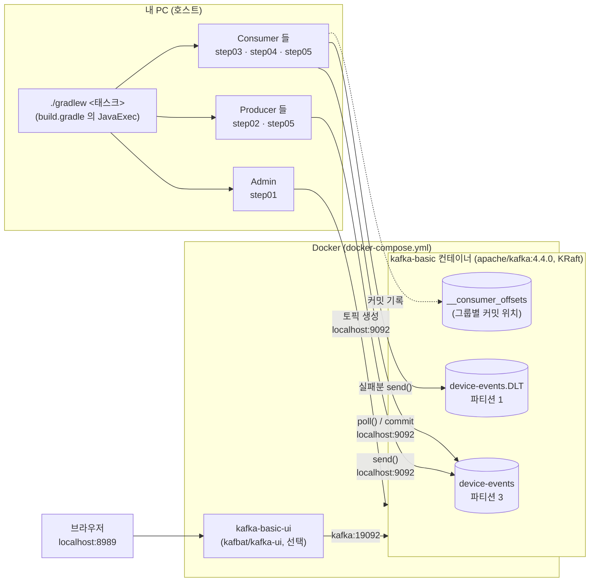
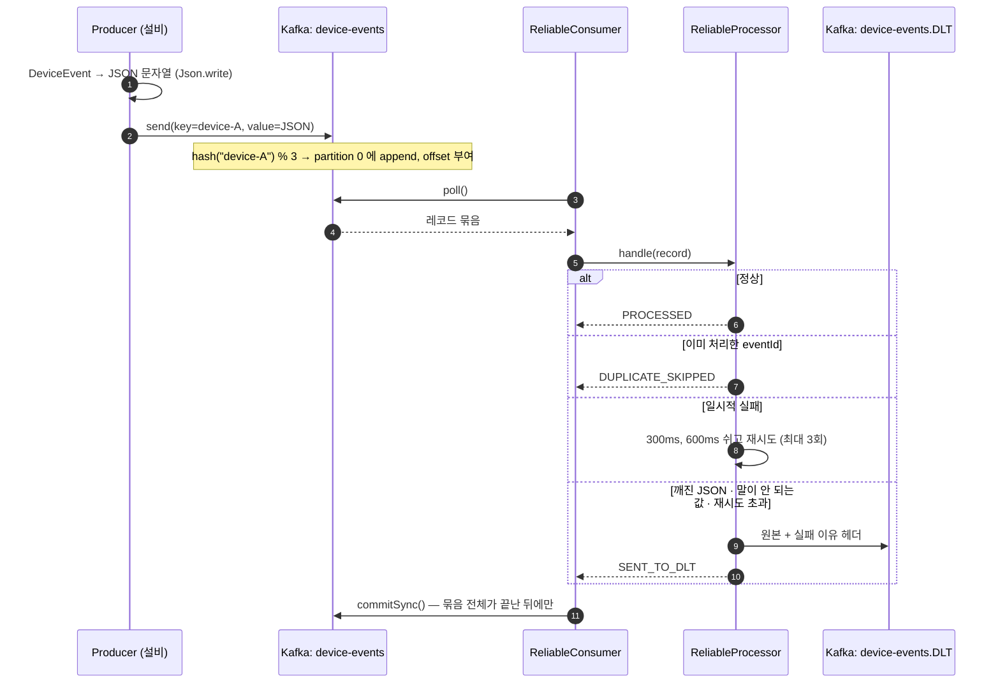
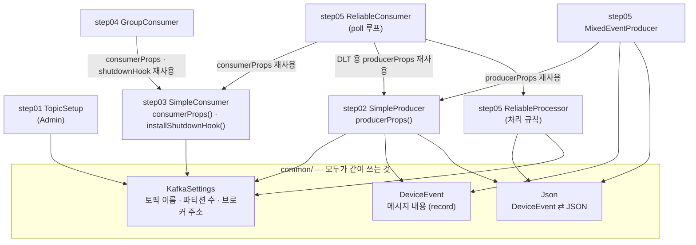
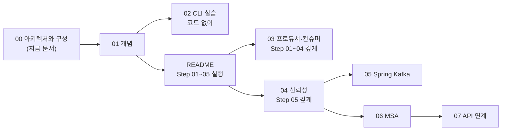

# 00. 아키텍처와 프로젝트 구성

> 코드를 열기 전에 **이 저장소가 무엇을 흉내 내는지, 무엇이 어디서 돌고, 파일 하나하나가 무슨 역할인지** 한 장에 정리한 문서.
> 처음이라면 이 문서 → [01-개념](01-개념.md) → README 의 Step 01 순서로 본다.

---

## 1. 한 줄 요약

**공장 설비(device-A/B/C)가 온도 같은 측정값을 Kafka 로 보내고, 처리 서비스가 그것을 받아 처리하며, 처리 못 한 건은 따로 빼 두는 파이프라인**을
Spring 없이 순수 Java(`kafka-clients`)로 단계별로 만들어 본다.

| 실제 세계 | 이 저장소에서 |
|---|---|
| 공장 설비 센서 | `SimpleProducer`, `MixedEventProducer` (가짜 이벤트 생성) |
| 이벤트 버스 | Docker 로 띄운 Kafka 브로커 1대 |
| 이벤트 처리 서비스 | `SimpleConsumer` → `GroupConsumer` → `ReliableConsumer` (점점 똑똑해진다) |
| 실패 보관함 | `device-events.DLT` 토픽 |
| 운영자 화면 | kafka-ui (선택) |

---

## 2. 전체 아키텍처

무엇이 **내 PC(호스트)** 에서 돌고, 무엇이 **Docker 컨테이너** 안에서 도는지가 핵심이다.



### 접속 주소가 두 개인 이유

| 누가 | 어디로 붙나 | 리스너 |
|---|---|---|
| 호스트의 Java 예제 | `localhost:9092` (또는 `KAFKA_PORT`) | `PLAINTEXT_HOST` |
| 컨테이너 안 (콘솔 도구, UI) | `kafka:19092` | `PLAINTEXT` |
| 브로커 내부 컨트롤러 | `kafka:9093` | `CONTROLLER` (KRaft 용, 직접 쓸 일 없음) |

자세한 이유는 [01-개념 §7](01-개념.md#7-리스너와-advertisedlisteners--가장-흔한-접속-문제).

### 실습용이라 일부러 단순화한 것

| 항목 | 이 저장소 | 운영 환경이라면 |
|---|---|---|
| 브로커 수 | 1대 | 3대 이상 |
| 복제 수(replication factor) | 1 | 보통 3 |
| 보안 | 평문(PLAINTEXT) | TLS + 인증(SASL) |
| 토픽 자동 생성 | 끔 (`step01` 에서 직접 생성) | 보통 끔 — 같다 |
| 중복 검사 저장소 | 메모리 `HashSet` (재시작하면 잊음) | DB 테이블 + 유일 제약 |

---

## 3. 메시지 한 건의 생애

`device-A` 의 온도 이벤트 하나가 끝까지 가는 길.



### 메시지 형식

| 부분 | 값 | 비고 |
|---|---|---|
| 토픽 | `device-events` | `KafkaSettings.TOPIC` |
| 키 | `deviceId` (예: `device-A`) | 같은 설비 → 같은 파티션 → 순서 보장 |
| 값 | JSON 문자열 | `DeviceEvent` 레코드 |
| 헤더 (DLT 만) | `dlt.reason`, `dlt.original.topic/partition/offset` | 왜, 어디서 실패했는지 |

```json
{"eventId":"7f3c…","deviceId":"device-A","type":"TEMPERATURE","value":21.5,"occurredAt":1764000000000}
```

- `eventId` 로 **중복**을 걸러 낸다 (Step 05).
- `type=FLAKY` 는 실습용 약속이다. 처리기가 두 번 실패한 척하다가 세 번째에 성공한다.

---

## 4. 코드 구조 — 누가 누구를 쓰나



**읽는 요령**: 뒤 단계는 앞 단계의 설정 메서드를 가져다 쓴다. 그래서 Step 02 의 `producerProps()` 와 Step 03 의 `consumerProps()` 를 이해하면
Step 04, 05 에서는 **새로 추가된 부분만** 보면 된다.

`ReliableConsumer`(Kafka 와 대화하는 루프)와 `ReliableProcessor`(한 건을 어떻게 처리할지)를 나눈 이유는 테스트 때문이다.
처리 규칙은 브로커 없이 `MockProducer` 로 검사할 수 있다.

---

## 5. 파일별 역할

```
kafka-basic/
├── docker-compose.yml              Kafka 브로커(KRaft) + 웹 UI(--profile ui 일 때만)
├── build.gradle                    의존성 + 실습 실행 태스크 (topic, produce, consume, group, produceBad, reliable)
├── docs/                           설명 문서 (아래 §7)
└── src/
    ├── main/java/com/clnewze/lab/kafka/
    │   ├── common/
    │   │   ├── KafkaSettings.java      토픽 이름, 파티션 수, 브로커 주소(KAFKA_BOOTSTRAP → KAFKA_PORT → 9092)
    │   │   ├── DeviceEvent.java        메시지 한 건의 모양
    │   │   └── Json.java               JSON 변환. 깨진 본문이면 예외 → Step 05 의 "영구 실패"
    │   ├── step01/TopicSetup.java      Admin 클라이언트로 토픽 2개 생성 + 파티션 정보 출력
    │   ├── step02/SimpleProducer.java  키 붙여 보내기. acks=all, 멱등 프로듀서, 콜백
    │   ├── step03/SimpleConsumer.java  poll 루프, 자동 커밋 끄고 처리 후 커밋, Ctrl+C 안전 종료
    │   ├── step04/GroupConsumer.java   같은 그룹 여러 개 → 파티션 분배, 리밸런스 리스너, 파티션별 커밋
    │   └── step05/
    │       ├── MixedEventProducer.java 정상 · 중복 · 깨진 JSON · 이상값 · 일시 실패를 섞어 보냄
    │       ├── ReliableConsumer.java   poll 루프 + DLT 용 프로듀서. 묶음 처리 후 commitSync
    │       └── ReliableProcessor.java  한 건 처리 규칙: 중복 건너뛰기 → 재시도 → DLT
    │   └── simulation/FactorySimulation.java  전체 시뮬레이션: 설비 5대 + 처리 서비스 3 + 모니터 + DLT 감시, 중간에 worker 장애, 결과 검증
    ├── main/resources/logback.xml      로그 형식. kafka-clients 내부 로그는 WARN 만 (설정값 덤프에 실습 출력이 묻히지 않게)
    └── test/java/com/clnewze/lab/kafka/
        ├── step05/ReliableProcessorTest.java   브로커 없이 처리 규칙 6가지 검사
        └── roundtrip/KafkaRoundTripIT.java     Testcontainers 로 진짜 Kafka 띄워 "같은 키 = 같은 파티션, 순서 유지" 검사
```

### Gradle 태스크 ↔ 클래스

| 명령 | 실행 클래스 | 하는 일 |
|---|---|---|
| `./gradlew topic` | `step01.TopicSetup` | 토픽 만들기 |
| `./gradlew produce -Pargs="N"` | `step02.SimpleProducer` | N건 보내기 |
| `./gradlew consume [-Pargs="그룹"]` | `step03.SimpleConsumer` | 받기 (기본 그룹 `step03`) |
| `./gradlew group -Pargs="worker-1"` | `step04.GroupConsumer` | 그룹 `step04` 의 일꾼 하나 |
| `./gradlew produceBad` | `step05.MixedEventProducer` | 문제 섞인 메시지 5건 |
| `./gradlew reliable [-Pargs="그룹"]` | `step05.ReliableConsumer` | 중복 · 재시도 · DLT 처리 (기본 그룹 `step05`) |
| `./gradlew simulate [-Pargs="초"]` | `simulation.FactorySimulation` | Step 01~05 전체를 main 하나로 (README 「시뮬레이션」) |

### 소비자 그룹 이름

그룹이 다르면 서로 영향을 주지 않는다. 그래서 단계마다 그룹 이름을 다르게 썼다.

| 그룹 | 쓰는 곳 | 의미 |
|---|---|---|
| `step03` | `consume` | 혼자 읽는 소비자 |
| `step04` | `group` | 여러 일꾼이 파티션을 나눠 읽음 |
| `step05` | `reliable` | 신뢰성 처리 소비자 |

→ 같은 `device-events` 를 세 그룹이 **각자 처음부터** 읽을 수 있다. 실무에서 "서비스 하나 = 그룹 하나" 와 같은 구조다.

---

## 6. 난이도 지도

| 단계 | 주제 | 난이도 | 막히면 |
|---|---|---|---|
| Step 01 | 토픽 · 파티션 | ★☆☆ 기초 | [01-개념 §2](01-개념.md) 용어 표 |
| Step 02 | 키 · offset · 비동기 전송 | ★☆☆ 기초 | [01-개념 §3](01-개념.md) |
| Step 03 | poll · 커밋 · 이어 읽기 | ★★☆ 기초 끝자락 | [01-개념 §5](01-개념.md) |
| Step 04 | 소비자 그룹 · 리밸런스 | ★★☆ 중급 입구 | 터미널 2~3개 띄워 직접 보기, [03](03-프로듀서-컨슈머.md) |
| Step 05 | 중복 · 재시도 · DLT | ★★★ 중급 | [04-신뢰성](04-신뢰성.md) |
| 문서 05~07 | Spring Kafka, MSA, API 연계 | ★★★ 응용 | Step 05 까지 끝낸 뒤에 |

**Step 03 까지가 "Kafka 기초"** 다. Step 04 부터는 분산 시스템의 성질(병렬 처리, 장애, 중복)이 나오기 시작하니,
한 번에 다 이해하려 하지 말고 **실행 결과를 눈으로 보는 것**을 먼저 하자.

---

## 7. 문서 지도


