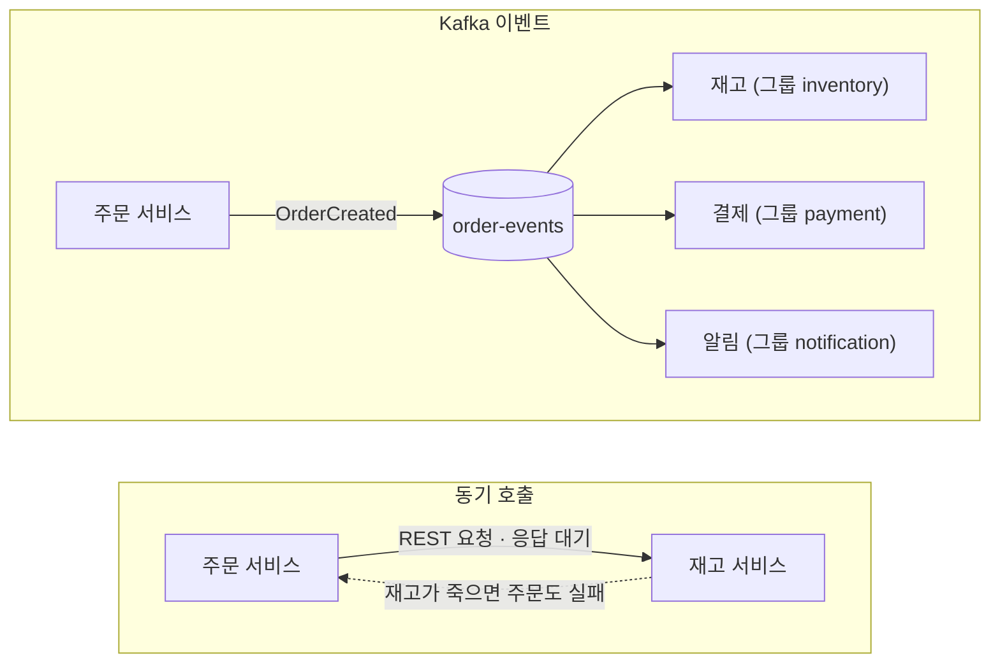
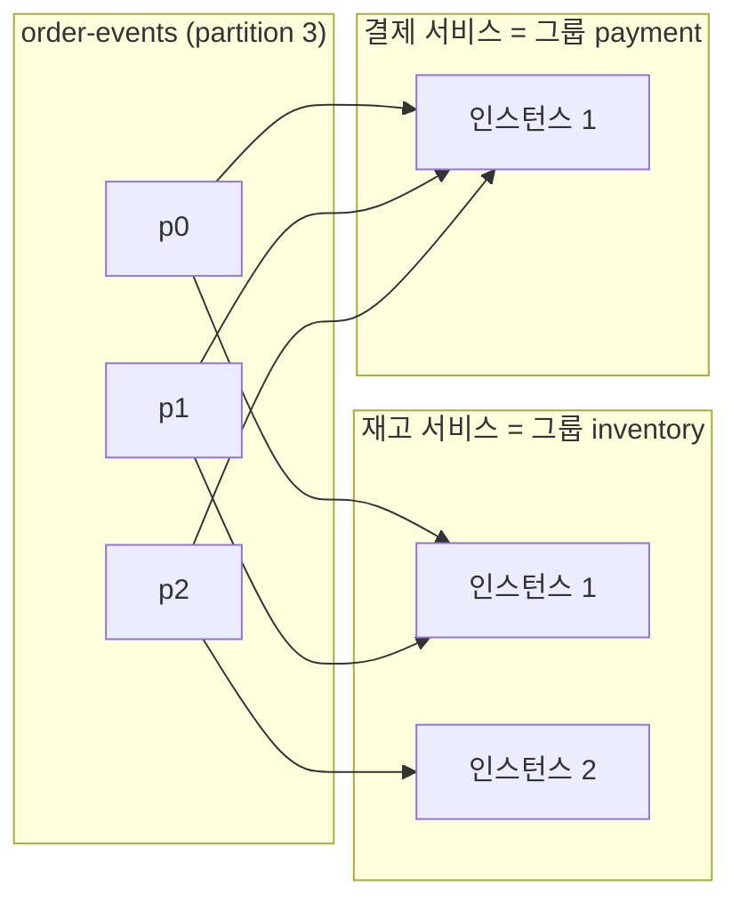
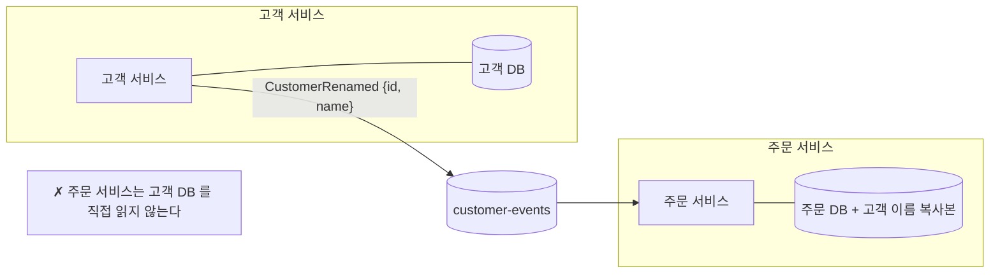
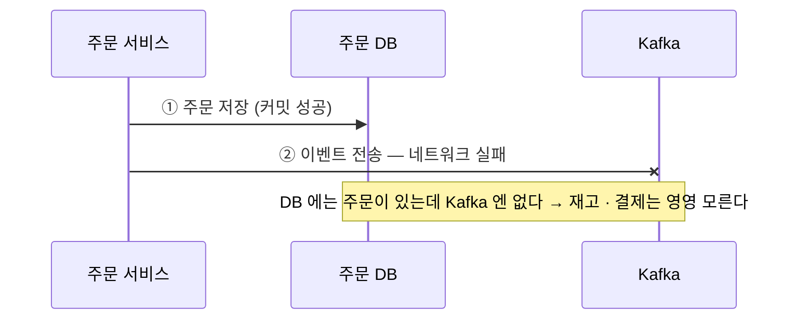
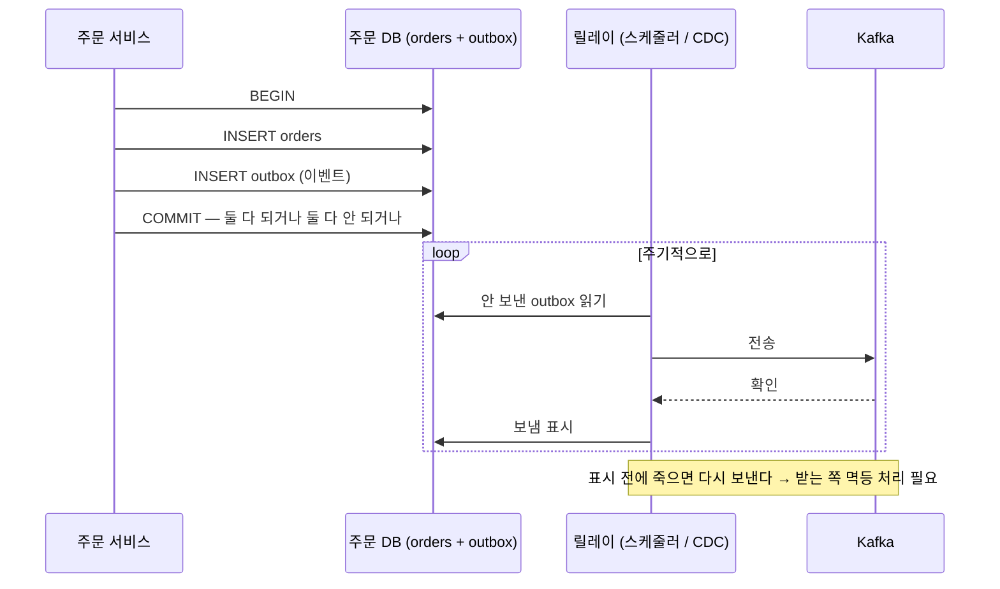
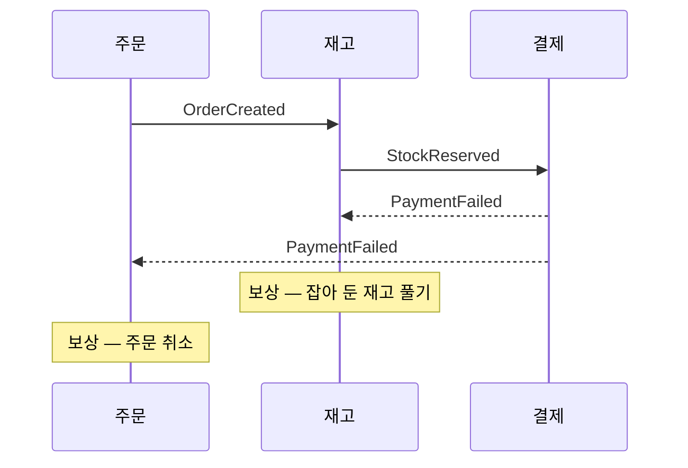
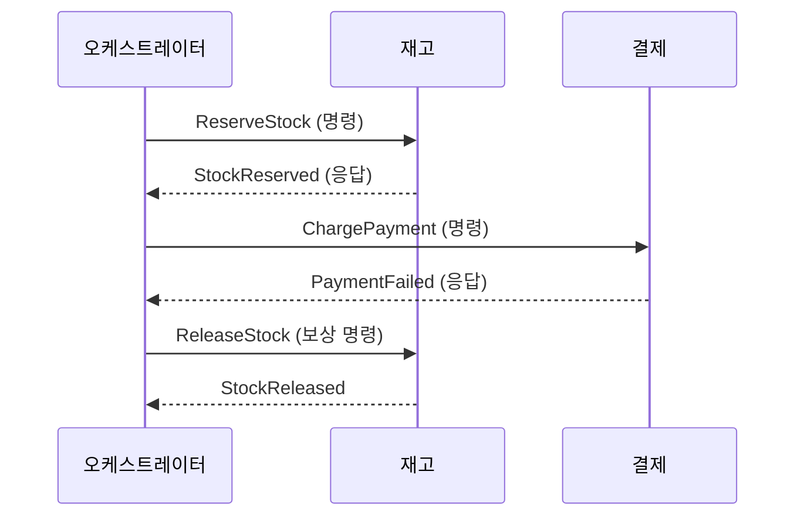
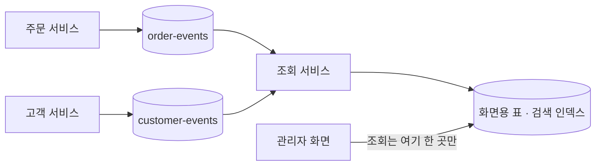

# 06. MSA 와 Kafka

마이크로서비스(MSA)에서 Kafka 가 **왜** 쓰이고, 앞 단계에서 배운 것이 서비스 사이에서 **어떤 문제를 푸는지** 정리한다.

## 1. 서비스끼리 어떻게 말하나 — 동기 vs 비동기

```
동기 (REST / gRPC)                        비동기 (Kafka)

 주문 ──요청──▶ 재고                        주문 ──"주문됨" 이벤트──▶ [order-events]
  │  ◀──응답──                                                     │      │      │
  │   (재고가 죽으면 주문도 실패)                                  재고    결제    알림
  ▼                                                              (각자 자기 속도로 읽는다)
```

| | 동기 호출 | Kafka 이벤트 |
|---|---|---|
| 결합 | 호출하는 쪽이 받는 쪽 주소 · API 를 안다 | 보내는 쪽은 **누가 읽는지 모른다** |
| 장애 | 받는 쪽이 죽으면 같이 실패 (연쇄 장애) | 받는 쪽이 죽어도 메시지는 토픽에 남아 있다가 나중에 처리 |
| 부하 | 몰리면 받는 쪽이 같이 터진다 | 토픽이 완충. 소비자는 자기 속도로 (LAG 이 늘 뿐) |
| 응답 | 바로 결과를 받는다 | 결과는 나중에, 다른 이벤트로 |
| 새 소비자 추가 | 호출하는 쪽 코드를 고쳐야 한다 | **그룹 하나 더 붙이면 끝** (보내는 쪽 무수정) |



**둘 중 하나만 쓰는 게 아니다.** "지금 답이 필요한 질문"(재고 몇 개?)은 동기, "일어난 사실의 전파"(주문됐다)는 이벤트.

## 2. 이 저장소에서 배운 것 → MSA 에서의 의미

| 개념 | MSA 에서 |
|---|---|
| **소비자 그룹** (Step 04) | **서비스 하나 = 그룹 하나.** 재고 · 결제 · 알림이 각자 그룹이라 같은 이벤트를 모두 받는다. 한 서비스의 인스턴스 여러 대는 같은 그룹 → 파티션을 나눠 처리(수평 확장) |
| **파티션 수** | 그 서비스를 몇 대까지 늘릴 수 있나의 상한. 나중에 늘리면 키 → 파티션 배치가 바뀌어 순서가 깨질 수 있으니 처음에 넉넉히 |
| **키** (Step 02) | **같은 대상(aggregate)의 이벤트는 같은 키로.** 주문 번호를 키로 쓰면 `생성 → 결제 → 취소` 순서가 지켜진다 |
| **offset · 보관** | 새 서비스가 생기면 과거 이벤트를 처음부터 읽어 자기 데이터를 채울 수 있다 (보관 기간 안이라면) |
| **at-least-once + 멱등** (Step 05) | 서비스 사이에서 중복 수신은 **반드시** 일어난다고 가정. 모든 소비 서비스가 eventId 로 멱등 처리 |
| **DLT** (Step 05) | 한 서비스의 데이터 오류가 그 서비스의 처리 전체를 막지 않게. DLT 는 서비스(그룹)마다 따로 둔다 |
| **LAG** | 서비스 건강 지표. LAG 이 계속 늘면 그 서비스가 못 따라가는 중 |

한 서비스 안의 인스턴스는 같은 그룹이라 칸을 나눠 받고, 서비스끼리는 그룹이 달라 각자 전부 받는다.



## 3. 서비스마다 DB 따로 — 그럼 데이터는 어떻게 맞추나

MSA 의 기본은 **Database per Service**: 다른 서비스의 DB 를 직접 읽지 않는다.
그러면 "주문 서비스에 고객 이름을 보여 주고 싶다" 같은 요구는?

| 방식 | 내용 | 장단 |
|---|---|---|
| 이벤트 알림 (Event Notification) | `{"orderId": 1, "type": "CREATED"}` 만 보냄. 필요하면 받는 쪽이 조회 API 호출 | 이벤트가 가볍다 / 결국 동기 호출이 생긴다 |
| 상태 실어 보내기 (Event-Carried State Transfer) | 필요한 필드를 이벤트에 담아 보냄. 받는 쪽이 **자기 DB 에 복사본**을 둠 | 호출 없음, 장애 격리 / 복사본은 **잠깐 늦을 수 있다** (최종 일관성) |



## 4. 이중 쓰기 문제와 Outbox 패턴 ⭐

가장 흔한 실수:

```java
@Transactional
void placeOrder(Order order) {
    orderRepository.save(order);                  // ① DB
    kafkaTemplate.send("order-events", event);    // ② Kafka
}
```

- ① 성공 → ② 실패: DB 에는 주문이 있는데 아무도 모른다
- ② 성공 → 트랜잭션 롤백: 없는 주문의 이벤트가 나갔다
- DB 트랜잭션 안에서 브로커를 부르면, 브로커가 느릴 때 DB 커넥션까지 붙잡힌다



**Transactional Outbox**:



```
① 같은 DB 트랜잭션에서            ② 별도 릴레이가
   orders 에 INSERT                 outbox 를 읽어 Kafka 로 보내고
   outbox 에 이벤트 INSERT          보낸 표시
        └──── 둘 다 되거나 둘 다 안 되거나 ────┘
```

- 릴레이는 폴링 스케줄러로 만들거나, CDC(Debezium 등 DB 로그를 읽는 도구)를 쓴다.
- 릴레이는 보낸 뒤 표시 전에 죽으면 **다시 보낸다** → 받는 쪽 멱등 처리(Step 05)가 여기서 필요해진다.
- 받는 쪽도 같은 원리: "처리 결과 저장 + 처리한 eventId 기록" 을 한 트랜잭션에 ([04-신뢰성 §4](04-신뢰성.md)).

## 5. 여러 서비스에 걸친 작업 — Saga

분산 트랜잭션(2PC) 대신, 각 서비스가 **자기 로컬 트랜잭션 + 이벤트**로 이어 가고, 실패하면 **보상 작업**(취소)을 한다.

```
Choreography (안무형) — 중앙 없음, 이벤트에 반응

 주문: 주문생성 ──▶ 재고: 재고확보 ──▶ 결제: 결제실패 ──▶ 재고: 재고복구
                                                      └──▶ 주문: 주문취소

Orchestration (지휘형) — 오케스트레이터가 명령을 보냄

 오케스트레이터 ──"재고 잡아라"(command)──▶ 재고 ──"잡았다"(reply)──▶ 오케스트레이터
               ──"결제해라"──────────────▶ 결제 ──"실패"────────────▶ 오케스트레이터
               ──"재고 풀어라"(보상)─────▶ 재고
```

Choreography 를 그림으로 (결제 실패 → 보상):



Orchestration:



| | Choreography | Orchestration |
|---|---|---|
| 단순한 흐름 (2 ~ 3 단계) | 잘 맞음 | 과함 |
| 흐름 전체 보기 | 어렵다 (코드가 흩어짐) | 오케스트레이터 하나만 보면 된다 |
| 결합 | 느슨 | 오케스트레이터가 모두를 안다 |

## 6. 이벤트 vs 명령

| | 이벤트 (Event) | 명령 (Command) |
|---|---|---|
| 뜻 | 이미 **일어난 사실** | 해 달라는 **요청** |
| 이름 | 과거형 `OrderCreated` | 명령형 `ReserveStock` |
| 받는 쪽 | 몇이든 (모름) | 정해진 하나 |
| 거절 | 못 한다 (이미 일어났다) | 할 수 있다 → 결과를 응답 이벤트로 |

명령을 Kafka 로 보낼 때는 **명령 ID 를 멱등성 키로** 두고, 상태를 `요청됨 → 보냄 → 성공 / 실패 / 모름` 으로 추적하면 "보냈는데 응답이 안 왔다" 를 다룰 수 있다.

## 7. 이벤트는 서비스 사이의 계약이다

토픽과 메시지 형식은 **공개 API 와 같다.** 바꾸면 모르는 소비자가 깨진다.

- **필드 추가는 괜찮게, 삭제 · 이름 변경 · 타입 변경은 하지 않게** (하위 호환)
- 소비자는 **모르는 필드를 무시**하게 만든다 (Jackson `FAIL_ON_UNKNOWN_PROPERTIES=false`)
- 크게 바꿔야 하면 새 토픽 또는 `version` 필드
- 팀이 많아지면 Schema Registry(Avro / Protobuf / JSON Schema)로 호환성을 브로커 앞에서 검사
- 이벤트에 `eventId`, `occurredAt`, 출처(source)는 항상 넣는다 — 이 저장소의 `DeviceEvent` 처럼

토픽 이름은 `<도메인>.<엔터티>.<종류>` 처럼 규칙을 정하고, **토픽마다 주인 서비스 하나**(그 서비스만 쓴다)를 둔다.

## 8. CQRS — 읽기 모델 따로

쓰기 서비스가 이벤트를 내면, 조회 전용 서비스가 그걸 받아 **조회에 맞춘 형태**(검색 인덱스, 집계 테이블, 화면용 표)로 쌓는다.


여러 서비스 데이터를 합친 화면이 필요할 때, 매번 여러 서비스를 호출하는 대신 이 읽기 모델 하나만 본다.

## 9. Kafka 가 맞지 않을 때

| 상황 | 이유 |
|---|---|
| 서비스가 2 ~ 3개, 트래픽 작음 | 운영 부담(브로커 · 모니터링)이 이득보다 크다. 동기 호출이나 DB 기반 큐로 충분 |
| 바로 결과가 필요한 조회 | 비동기는 응답을 기다리는 구조에 맞지 않는다 |
| 메시지마다 다른 지연 · 우선순위 · 개별 삭제 | 전통적인 메시지 큐(RabbitMQ 등)가 더 자연스럽다 |
| 강한 일관성이 꼭 필요한 한 덩어리 | 서비스를 나누지 않는 게 답일 수 있다 |

## 10. 정리

```
Step 02 키         → 같은 대상의 이벤트 순서
Step 03 커밋       → 서비스가 죽었다 살아나도 이어서
Step 04 그룹       → 서비스 하나 = 그룹 하나, 인스턴스 늘리기
Step 05 멱등 · DLT → 중복은 반드시 온다, 나쁜 메시지 하나가 서비스를 멈추지 않게
+ Outbox           → DB 와 이벤트를 어긋나지 않게 내보내기
+ Saga             → 여러 서비스에 걸친 작업과 보상
```
