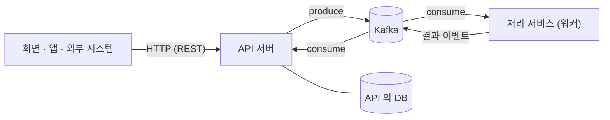
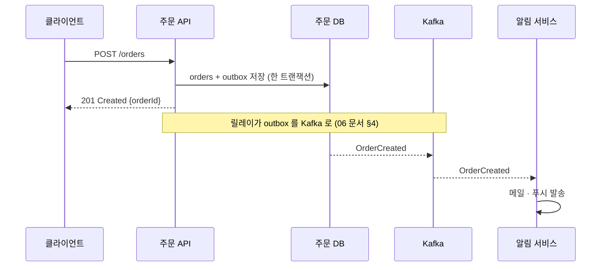
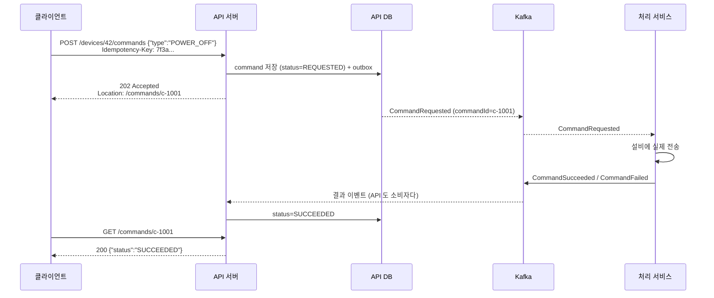
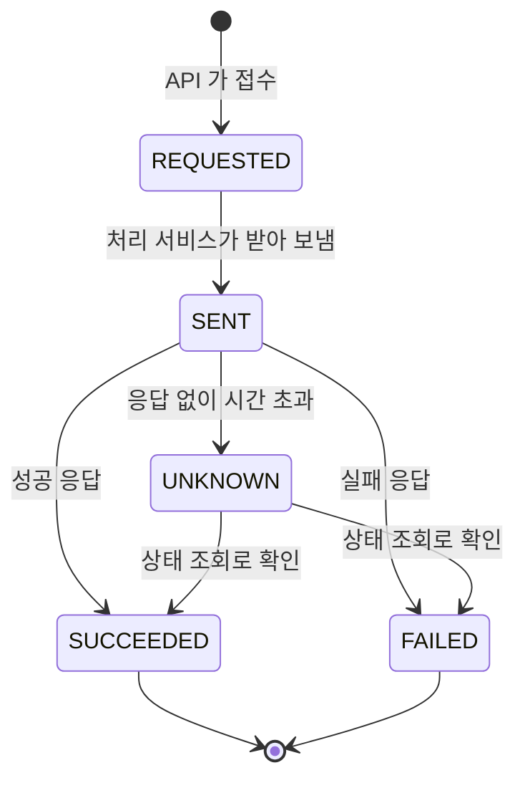
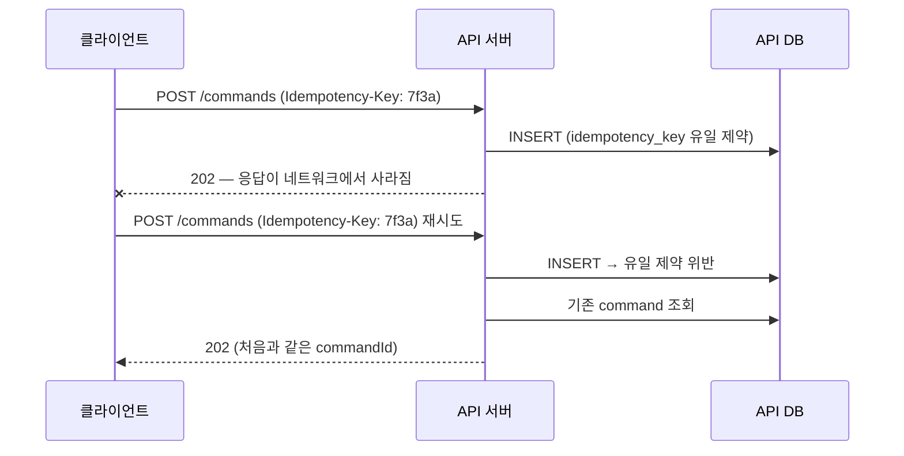
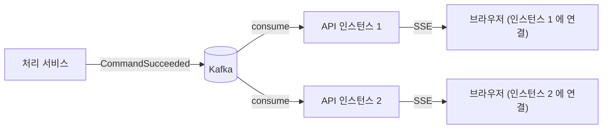
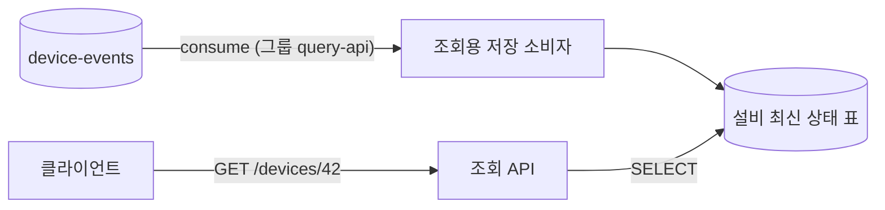
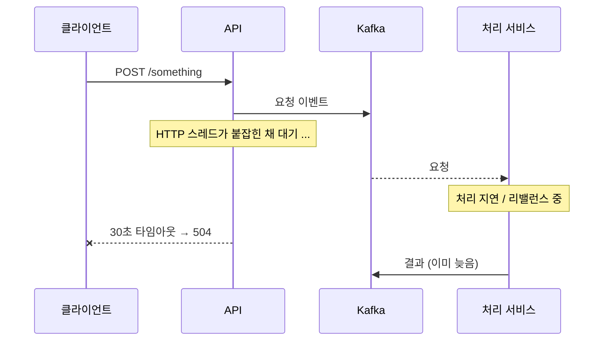

# 07. API 와 Kafka 연계

화면(브라우저 · 앱)은 Kafka 에 직접 붙지 않는다. **화면은 REST API 를 부르고, API 서버가 Kafka 와 이야기한다.**
이 문서는 "HTTP 요청 한 번" 과 "Kafka 의 비동기 처리" 를 어떻게 이어 붙이는지 정리한다.



> 왜 화면이 Kafka 에 직접 안 붙나: Kafka 는 인증 · 권한 · 입력 검증 · 응답 형식을 화면에 맞게 해 주지 않는다.
> 그건 API 서버의 일이다. Kafka 는 **서버들 사이**의 통로다.

---

## 1. 패턴 한눈에

| 패턴 | 요청 → 응답 | 언제 |
|---|---|---|
| A. 저장하고 이벤트 알림 | `201 Created` 즉시 | 주문 생성처럼 **API 가 결과를 바로 아는** 경우. 후속 처리(알림 · 통계)는 이벤트로 |
| B. 접수하고 나중에 결과 (비동기 요청-응답) | `202 Accepted` + 조회 주소 | 오래 걸리거나 **다른 시스템이 해야 결과를 아는** 경우 (설비 제어, 결제 승인, 파일 변환) |
| C. 결과를 밀어 주기 | 202 + SSE / WebSocket / Webhook | B 에서 클라이언트가 조회를 반복하지 않게 |
| D. 조회는 읽기 모델에서 | `200 OK` | 조회 API 는 **Kafka 를 읽지 않는다.** 이벤트로 채워 둔 DB 를 읽는다 |
| ✗ Kafka 로 동기 요청-응답 흉내 | HTTP 를 붙잡고 Kafka 응답 대기 | 되도록 쓰지 않는다 (§6) |

---

## 2. 패턴 A — 저장하고 이벤트 알림



- 응답은 **DB 저장이 끝난 시점**에 준다. Kafka 전송 성공을 기다리지 않는다.
- API 코드 안에서 `save()` 다음에 바로 `kafkaTemplate.send()` 하면 둘이 어긋날 수 있다 → **Outbox** ([06 §4](06-MSA-와-Kafka.md#4-이중-쓰기-문제와-outbox-패턴-)).
- 알림이 늦거나 실패해도 주문 API 는 영향을 받지 않는다. 이게 Kafka 를 두는 이유.

---

## 3. 패턴 B — 접수하고 나중에 결과 (202 Accepted)

API 가 직접 끝낼 수 없는 일. 예: 설비에 "전원 꺼라" 명령, 외부 결제 승인, 대용량 파일 변환.



### 상태를 표로 남긴다



- **`UNKNOWN` 을 따로 둔다.** 응답이 안 왔다고 실패가 아니다 — 실제로는 됐을 수도 있다. 다시 보내기 전에 조회로 확정한다.
- 결과 이벤트는 **API 서버가 소비자 그룹으로 받아** 자기 DB 를 고친다. 클라이언트는 DB 를 조회할 뿐이다.

### 같은 요청이 두 번 오면 — Idempotency-Key

클라이언트는 응답을 못 받으면 **다시 보낸다.** 그러면 명령이 두 번 나간다.



- 키는 **클라이언트가 만든다** (UUID). 서버는 키에 유일 제약을 걸고, 이미 있으면 처음 결과를 그대로 돌려준다.
- 이 키(또는 commandId)를 Kafka 메시지에도 실어 보낸다 → 소비자 쪽 중복 처리(Step 05)도 같은 키로 막는다.
- 끝에서 끝까지 **같은 ID 하나**로 중복을 막는 게 요점이다.

```
클라이언트 ── Idempotency-Key ──▶ API (유일 제약) ── commandId ──▶ Kafka ──▶ 소비자 (eventId 로 중복 건너뜀)
```

---

## 4. 패턴 C — 결과를 밀어 주기

B 에서 클라이언트가 `GET /commands/{id}` 를 1초마다 부르는 대신:

| 방식 | 대상 | 특징 |
|---|---|---|
| 폴링 (`GET` 반복) | 무엇이든 | 가장 단순. 간격만 적당히 |
| **SSE** (Server-Sent Events) | 브라우저 | 서버 → 클라이언트 한 방향. HTTP 그대로라 붙이기 쉽다 |
| WebSocket | 브라우저 · 앱 | 양방향. 관제 화면처럼 계속 바뀌는 화면 |
| Webhook | 외부 시스템 | 결과가 나오면 상대 서버의 URL 을 호출 |



**주의 — API 가 여러 대일 때**: 브라우저는 API 인스턴스 하나에 연결돼 있는데, 결과 이벤트는 그룹 안에서 **한 인스턴스만** 받는다 (Step 04).
그 인스턴스가 이 브라우저를 모를 수 있다. 해결책:

- 푸시용 소비자는 **인스턴스마다 다른 그룹 이름**(예: `api-push-<호스트명>`)으로 → 모든 인스턴스가 다 받고, 자기 연결만 골라 보낸다
- 또는 Redis Pub/Sub 같은 별도 전달 경로를 둔다
- DB 갱신용 소비자는 **공통 그룹 하나** → 한 번만 처리 (둘을 섞지 않는다)

---

## 5. 패턴 D — 조회 API 는 Kafka 를 읽지 않는다



- Kafka 는 "키로 한 건 꺼내기" 를 잘하지 못한다. 끝에서부터 훑어야 한다.
- 이벤트를 받아 **조회하기 좋은 표**(설비별 최신 상태, 일별 집계)를 미리 만들어 두고, API 는 그 표만 읽는다 (CQRS, [06 §8](06-MSA-와-Kafka.md#8-cqrs--읽기-모델-따로)).
- 그래서 조회 결과는 이벤트보다 **조금 늦을 수 있다**. 화면에 "마지막 갱신 시각" 을 같이 보여 주면 좋다.

---

## 6. 하지 말 것 — HTTP 를 붙잡고 Kafka 응답 기다리기



- 처리 서비스의 지연 · 리밸런스 · LAG 이 그대로 **HTTP 타임아웃**이 된다. 비동기로 나눈 의미가 없어진다.
- 응답이 다른 API 인스턴스로 갈 수도 있다 (§4 와 같은 문제).
- 정말 필요하면 Spring Kafka 의 `ReplyingKafkaTemplate` 처럼 응답 토픽 + 상관 ID 로 만들 수는 있지만, 대부분은 **202 + 상태 조회**(패턴 B)가 더 단순하고 튼튼하다.
- 바로 답이 필요한 질문이면 Kafka 가 아니라 **그냥 동기 API 호출**이 맞다.

---

## 7. API 가 정하는 것 vs Kafka 가 정하는 것

| 항목 | REST API | Kafka 메시지 |
|---|---|---|
| 계약 | OpenAPI 문서, URL · 상태 코드 | 토픽 이름, 메시지 형식(스키마), 키 |
| 버전 | `/v1/...` | 필드 추가만 · `version` 필드 · 새 토픽 |
| 식별자 | `Idempotency-Key`, 리소스 ID | `eventId` / `commandId` (같은 값을 이어 쓴다) |
| 추적 | `X-Request-Id` | 헤더에 같은 값을 실어 보낸다 (`traceId`) → 로그를 끝까지 따라갈 수 있다 |
| 오류 | 4xx · 5xx 응답 | DLT, 실패 결과 이벤트 |
| 시간 | 타임아웃 몇 초 | 보관 기간 며칠 |

**요청 ID 를 Kafka 헤더로 넘기는 예** (이 저장소의 코드에 붙인다면):

```java
ProducerRecord<String, String> record = new ProducerRecord<>(TOPIC, deviceId, body);
record.headers().add("traceId", requestId.getBytes(StandardCharsets.UTF_8));
producer.send(record);
```

받는 쪽은 `record.headers().lastHeader("traceId")` 를 꺼내 로그(MDC)에 넣는다.

---

## 8. 이 저장소로 흉내 내 보기

API 서버는 없지만, 역할을 나눠 보면 이렇게 된다.

| 역할 | 이 저장소 |
|---|---|
| API 가 접수하고 이벤트를 보냄 | `SimpleProducer` / `MixedEventProducer` 가 그 자리 |
| 처리 서비스 | `ReliableConsumer` |
| 처리 실패 기록 | `device-events.DLT` |
| 중복 막기 | `ReliableProcessor` 의 eventId 검사 (실무: API 의 Idempotency-Key 와 같은 값) |

연습 과제로 좋은 것: JDK 내장 `com.sun.net.httpserver.HttpServer` 로 `POST /events` 하나를 만들어
요청 본문을 `device-events` 로 보내고 `202 Accepted` 를 돌려주게 해 보기. 프레임워크 없이도 "API → Kafka" 연결이 보인다.
